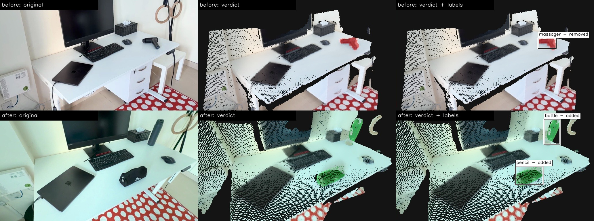
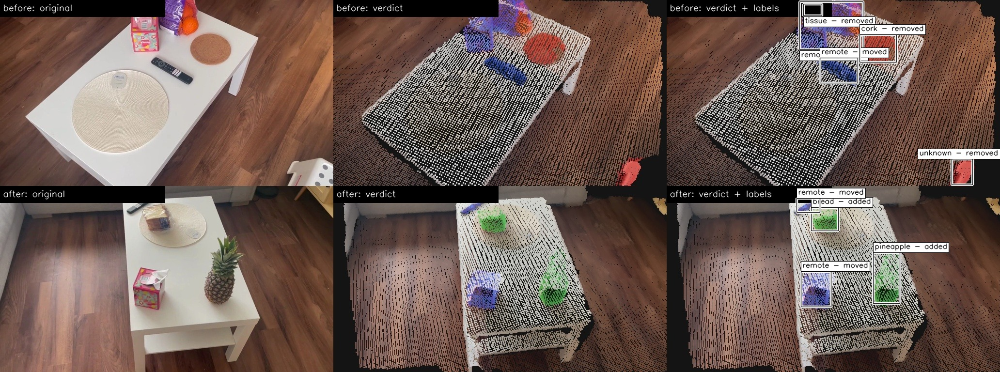
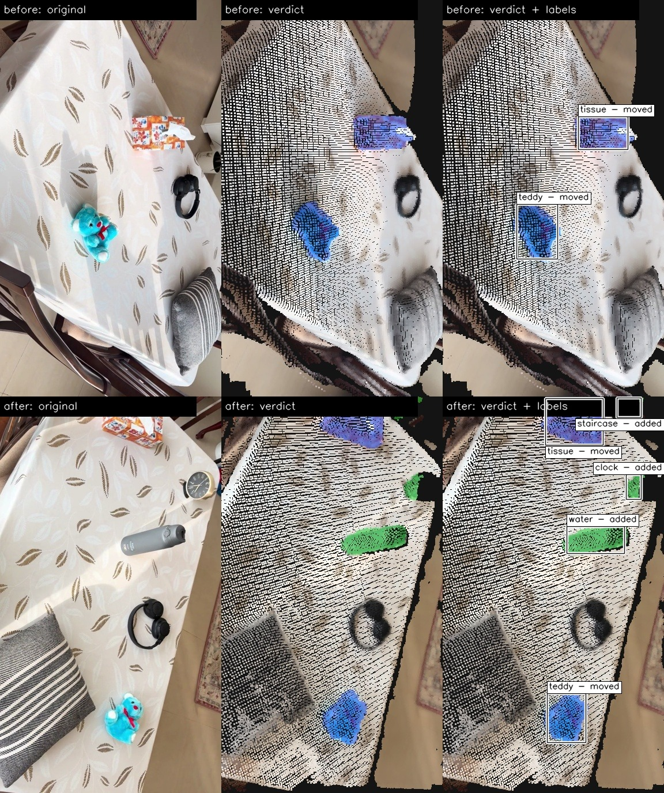
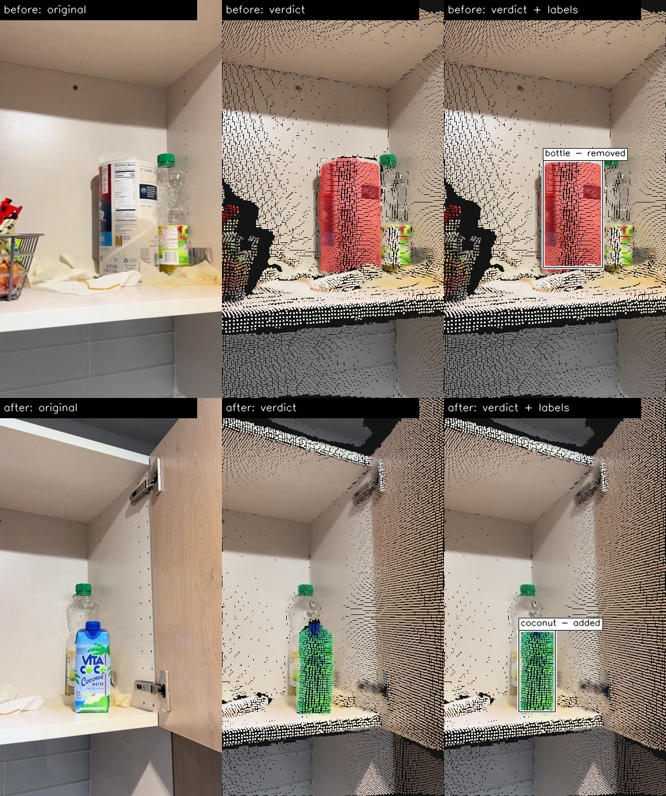
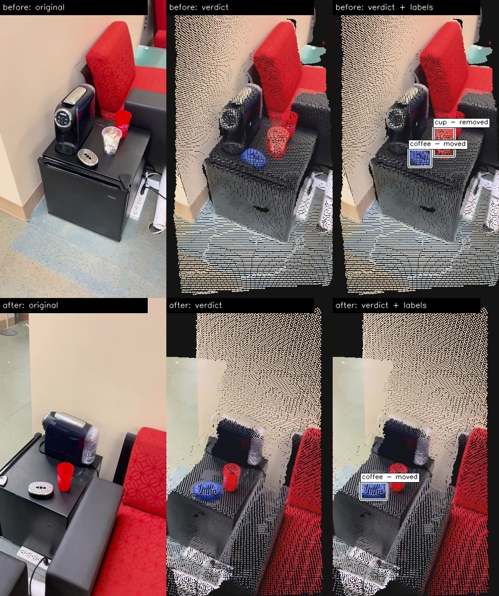
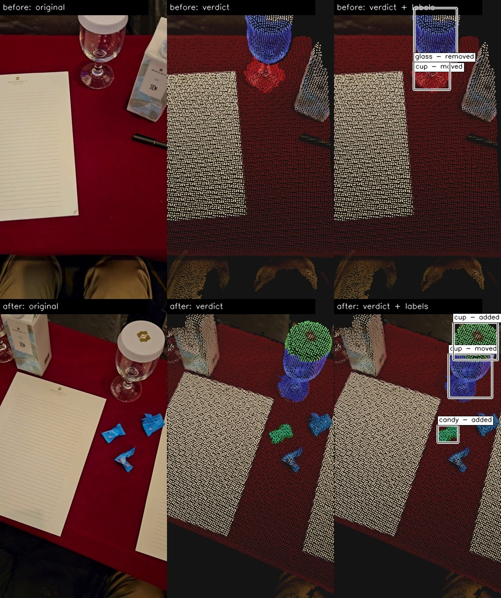
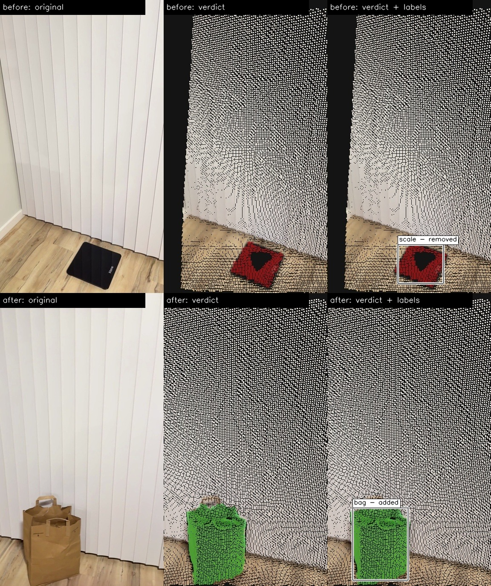
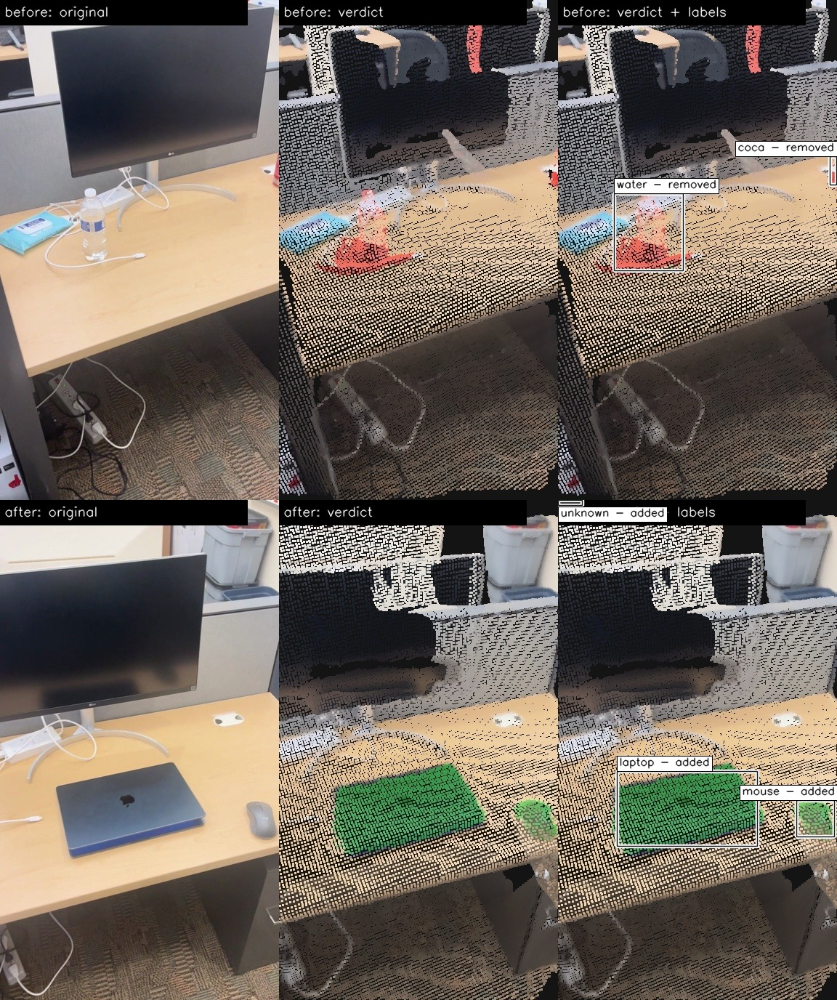

# Humanoid Challenge: Spatial AI and Navigation

Compares two phone videos of the same area and finds objects that were **moved**, **added** or **removed**, in 3D, and names each one.

- **Live demo:** [huggingface.co/spaces/Vinay0409/humanoid-spatial](https://huggingface.co/spaces/Vinay0409/humanoid-spatial) (browse the examples, or upload your own pair of videos). Sign in to Hugging Face first: logged-in users get a larger free GPU quota for uploads.

## Results

- **Eight scenes.** Two are my own phone recordings (`desk`, `dining_table`). The other six (`scene_diff_*`) come from the public [SceneDiff benchmark](https://huggingface.co/datasets/yuqun/SceneDiff) (Wu et al., ECCV 2026, MIT licence), added to check the pipeline on videos I did not film. I used six sequence pairs, re-encoded with metadata removed. The full dataset is not included.
- Each image, left to right: the original frame, the verdict, and the verdict with labels. Before on top, after below. Blue = moved, green = added, red = removed; unchanged points keep their true colours.




- Each scene also gets a plain-English change list (`changes.txt`). For `desk`:
  - A massager was removed.
  - A bottle was added.
  - A pencil was added.

- All 8 scenes, with the labels the vision-language model gave (m / r / a = moved / removed / added). Expected counts are hand-read from the videos.

| Scene | Expected m / r / a | Found m / r / a | Moved | Removed | Added |
|---|---|---|---|---|---|
| desk | 1 / 1 / 2 | 0 / 1 / 2 | - | massager | bottle, pencil |
| dining_table | 3 / 0 / 2 | 2 / 0 / 3 | teddy, tissue | - | clock, staircase, water |
| scene_diff_cabinet | 0 / 1 / 1 | 0 / 1 / 1 | - | bottle | coconut |
| scene_diff_coffee_table | 1 / 1 / 0 | 1 / 1 / 0 | coffee | cup | - |
| scene_diff_glass_table | 1 / 1 / 1 | 1 / 2 / 2 | cup | glass, pen | candy, cup |
| scene_diff_living_room | 2 / 2 / 2 | 2 / 3 / 2 | remote, remote | cork, tissue, unknown | bread, pineapple |
| scene_diff_living_room_2 | 0 / 1 / 1 | 0 / 1 / 1 | - | scale | bag |
| scene_diff_workstation | 0 / 1 / 2 | 0 / 3 / 3 | - | coca, water, window | laptop, mouse, unknown |

- Counts match on 3 of 8 scenes and are within one on 2 more. The labels are mostly right ("mouse", "bottle", "pineapple", "remote"); a few are off ("staircase", "window", "coca"), since the model answers with a single word.
- All 8 scenes are shown at the end of this page.

## How it works

- **1. Key frames.** The sharpest frame from each short time window of each video.
- **2. 3D reconstruction.** [VGGT-Omega](https://github.com/facebookresearch/vggt-omega) runs once on both videos together, so they share one coordinate frame. Output: depth and camera pose per frame.
- **3. Features.** [DINOv3](https://huggingface.co/facebook/dinov3-vitb16-pretrain-lvd1689m) patch features per frame.
- **4. Point clouds.** TSDF fusion, outlier removal, fixed point order. ICP only polishes the alignment, and the run stops if the correction is large.
- **5. Per-point features.** Each 3D point averages the DINOv3 features of the frames that see it.
- **6. Segmentation.** Peel off the large planes (desk, floor, walls) with RANSAC. Group the remaining points by proximity and DINOv3 similarity, so each object grows from nearby points that look alike.
- **7. Change evidence, per point.**
  - Geometric: the other video's cameras saw through this spot, so nothing was there.
  - Appearance: DINOv3 and colour differ from the nearest point in the other video (robust z-score).
- **8. Matching.** Changed segments and change regions become units. Units are matched across videos by DINOv3 feature, colour histogram and shape. Matched = moved, unmatched in before = removed, unmatched in after = added.
- **9. Naming.** For each unit, the key frames that show it best are cropped and shown to a small vision-language model ([Qwen3-VL-2B](https://huggingface.co/Qwen/Qwen3-VL-2B-Instruct)): "What object is this? Answer with one word." Majority vote; a moved object pools its views from both videos.

## Design decisions

- **Reconstruct both videos together.** One VGGT-Omega pass puts them in one coordinate frame, so no change is an alignment artefact.
- **Sharpest key frames.** The sharpest frame in each time window is kept, so every frame is good for reconstruction while the even spacing keeps overlap between neighbouring views.
- **Two kinds of evidence.** Geometry catches objects that left or arrived. Appearance catches flat or swapped objects that geometry cannot see.
- **Occlusion-aware.** "Removed" needs enough of the other video's cameras to see empty space there. A hidden spot is unknown, not removed.
- **Plain, explainable segmentation.** Peel the planes, then group the rest by proximity and feature similarity.
- **Alternative methods tried.** Supervoxel graph segmentation and SAM 2.1 masks. Both sometimes missed segments, so the simpler plane-peeling method was kept.
- **Small VLM, one word.** Runs on a laptop. "unknown" is an allowed answer, so it does not guess.

## Run it

- **Just want to try it?** Upload two videos on the [Hugging Face Space](https://huggingface.co/spaces/Vinay0409/humanoid-spatial). Sign in first for a larger GPU quota.
- To run it on your own machine you need git and Python 3.11 or 3.12. A GPU (CUDA or Apple) is optional but much faster.

```bash
# 1. get the code
git clone https://github.com/VinayMohan0409/humanoid-spatial.git
cd humanoid-spatial

# 2. install
python -m venv .venv
source .venv/bin/activate          # Windows: .venv\Scripts\activate
pip install -r requirements.txt

# 3. log in to Hugging Face (once), after accepting the two licences below
hf auth login

# 4. run it on your two videos
python pipeline/main.py before.mp4 after.mp4 --name my_scene
```

- Accept the terms on both gated model pages first: [VGGT-Omega](https://huggingface.co/facebook/VGGT-Omega) and [DINOv3](https://huggingface.co/facebook/dinov3-vitb16-pretrain-lvd1689m). The Qwen model is open.
- All weights download on the first run (several GB). The device is picked automatically: CUDA, then Apple GPU, then CPU.
- Add `--no-labels` to skip the naming step.
- Results appear in `output/my_scene/diagnose/`:
  - `verdict_labelled.jpg`: original frame, verdict and labelled verdict for each video
  - `before_verdict_colour.ply`, `after_verdict_colour.ply`: tinted point clouds (open in MeshLab or CloudCompare)
  - `changes.txt`: one plain-English sentence per change
  - `verdicts.json`: every changed object with its verdict, centroid, label and the sentences
  - `labels/`: the crops the VLM was shown
- Filming: move, add or remove a few objects between takes, film from different viewpoints, and keep enough overlap.

## Limitations and future work

- These are limits of a time-boxed project, not of the idea.
- **False positives and false negatives remain** (see the results table: extra removed or added objects in `glass_table`, `living_room` and `workstation`, a missed move in `desk` and `dining_table`). The thresholds still need fine-tuning on more scenes.
- **Small, low-contrast objects can be missed.** DINOv3 patches are 16 px, so a small dark object on a pale desk blends into its surroundings and is dropped as an empty footprint (the mouse on `desk`). Future work: let the vision-language model confirm candidates, or point at objects directly, and use those as seeds for grouping.
- **Fragmented objects.** An object that segmentation splits can be reported as several changes. Future work: merge fragments using the model's labels.
- **Labels are one word,** so they can be vague or truncated ("coca" for a cola bottle). Future work: allow short phrases, vote over more views.

## Licences

- Own code: MIT ([LICENSE](LICENSE)).
- **VGGT-Omega (code and weights): FAIR Noncommercial Research License. Research use only.**
- **DINOv3: DINOv3 License.**
- Qwen3-VL-2B: Apache-2.0. SceneDiff: MIT.
- Models, data and libraries, with citations: [EXTERNAL_REPOS.md](EXTERNAL_REPOS.md).

## All example results

- Same layout in every image, left to right: the original frame, the verdict, and the verdict with labels. Before on top, after below. Blue = moved, green = added, red = removed.
- Labels come from a small vision-language model and are sometimes wrong. The change list under each image is its plain-English output.

### desk (own recording)


- A massager was removed.
- A bottle was added.
- A pencil was added.

### dining_table (own recording)



- The tissue was moved.
- The teddy was moved.
- A water was added.
- A clock was added.
- A staircase was added.

### scene_diff_cabinet (SceneDiff)



- A bottle was removed.
- A coconut was added.

### scene_diff_coffee_table (SceneDiff)



- A cup was removed.
- The coffee was moved.

### scene_diff_glass_table (SceneDiff)



- The cup was moved.
- A glass was removed.
- A pen was removed.
- A cup was added.
- A candy was added.

### scene_diff_living_room (SceneDiff)


- The remote was moved.
- An unidentified object was removed.
- The remote was moved.
- A tissue was removed.
- A cork was removed.
- A pineapple was added.
- A bread was added.

### scene_diff_living_room_2 (SceneDiff)



- A scale was removed.
- A bag was added.

### scene_diff_workstation (SceneDiff)



- A water was removed.
- A coca was removed.
- A window was removed.
- A laptop was added.
- A mouse was added.
- An unidentified object was added.
